# Issue

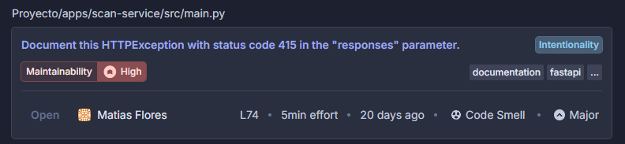

## Issue Description

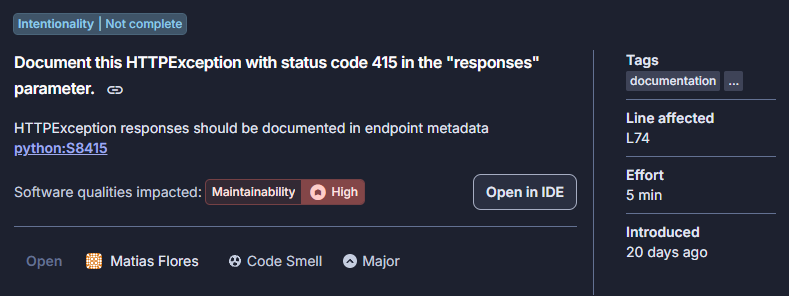

## Where's the Issue?

> Proyecto/apps/scan-service/src/main.py

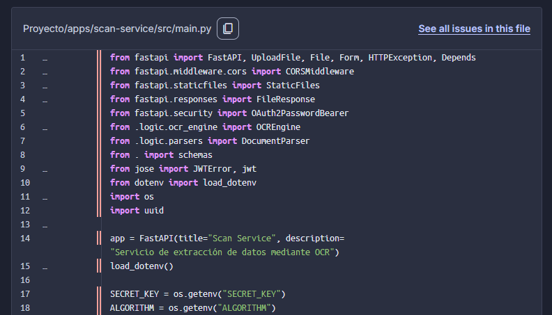

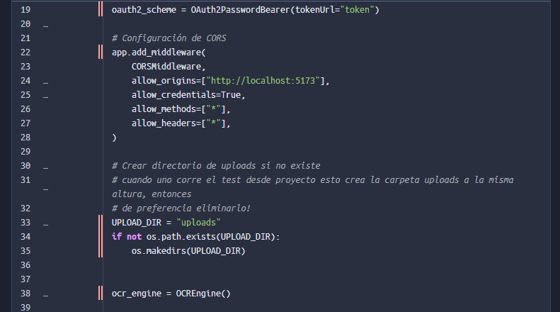

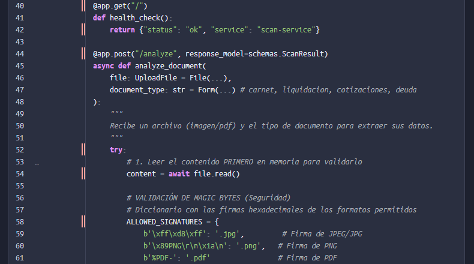

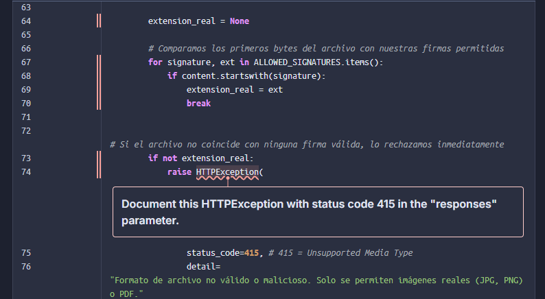

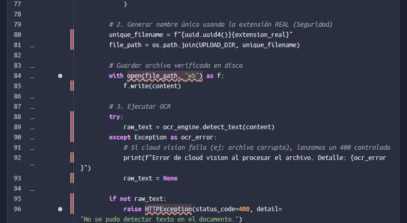

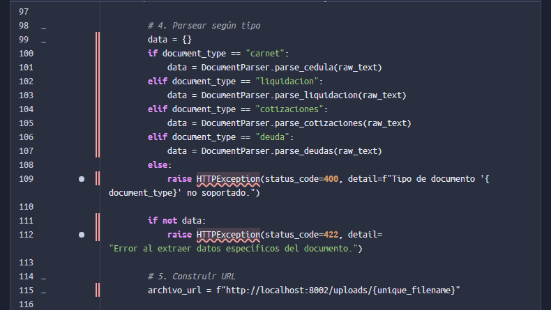

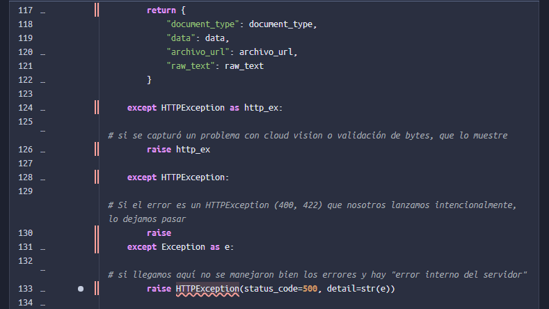

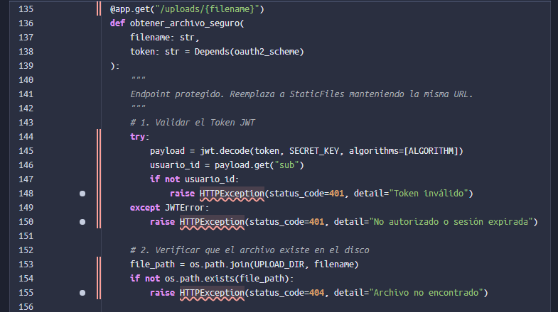

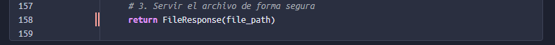

## Why is this an Issue?

FastAPI automatically generates OpenAPI (Swagger) documentation for your API endpoints. This documentation is crucial for API consumers to understand how to interact with your API, including what error responses they might encounter.

When you raise `HTTPException` in your endpoint code, FastAPI will return the specified HTTP status code and error details at runtime. However, unless you explicitly document these exceptions in the `responses` parameter of your endpoint decorator, they won’t appear in the automatically generated API documentation.

This creates a gap between what your API actually does and what the documentation says it does. API consumers looking at your OpenAPI specification will not see these error responses, making it harder for them to:
- Understand all possible outcomes when calling the endpoint
- Write proper error handling code in their applications
- Debug issues when they encounter undocumented error responses
- Trust the completeness of your API documentation

The `responses` parameter in FastAPI endpoint decorators exists specifically to document all possible HTTP responses, including error cases. By documenting your `HTTPException` raises, you ensure that the OpenAPI specification accurately reflects your API’s behavior, improving the developer experience for anyone consuming your API.

#### What is the potential impact?

When HTTPException responses are not documented:
- **API documentation is incomplete**: The automatically generated OpenAPI/Swagger documentation will not show all possible error responses, misleading API consumers about the endpoint’s behavior.
- **Integration difficulties**: Developers integrating with your API may be surprised by undocumented error responses, leading to incomplete error handling and potential runtime failures.
- **Reduced trust**: Incomplete documentation reduces confidence in the API and may lead developers to question what other behaviors are undocumented.
- **Maintenance challenges**: Without explicit documentation, it becomes harder to track what error responses an endpoint can return, making refactoring and maintenance more difficult.

## How can I fix it?

### How can I fix it in FastAPI?

Add the `responses` parameter to your endpoint decorator, documenting each HTTPException status code that can be raised. The key should be the status code, and the value should be a dictionary with at least a `description` field explaining when this error occurs.

#### Noncompilant code example

```bash
@app.get("/users/{user_id}")
def get_user(user_id: int):
    if user_id not in users:
        raise HTTPException(status_code=404, detail="User not found")  # Noncompliant
    return users[user_id]
```

#### Compliant solution

```bash
@app.get(
    "/users/{user_id}",
    responses={404: {"description": "User not found"}}
)
def get_user(user_id: int):
    if user_id not in users:
        raise HTTPException(status_code=404, detail="User not found")
    return users[user_id]
```

For endpoints that can raise multiple different HTTPException status codes, document all of them in the `responses` parameter. Each status code should have a clear description of when it occurs.

#### Noncompilant code example

```bash
@app.post("/items")
def create_item(item: Item):
    if not item.name:
        raise HTTPException(status_code=422, detail="Name is required")  # Noncompliant
    if len(item.name) > 100:
        raise HTTPException(status_code=422, detail="Name too long")  # Noncompliant
    return item
```

#### Compliant solution

```bash
@app.post(
    "/items",
    responses={
        422: {"description": "Validation error: Name is required or too long"}
    }
)
def create_item(item: Item):
    if not item.name:
        raise HTTPException(status_code=422, detail="Name is required")
    if len(item.name) > 100:
        raise HTTPException(status_code=422, detail="Name too long")
    return item
```

You can provide more detailed response documentation by including a model or additional fields. This is especially useful for complex error responses.

#### Noncompilant code example

```bash
@app.post("/items")
def create_item(item: Item):
    if not item.name:
        raise HTTPException(status_code=422, detail="Name is required")  # Noncompliant
    if len(item.name) > 100:
        raise HTTPException(status_code=422, detail="Name too long")  # Noncompliant
    return item
```

#### Compliant solution

```bash
@app.post(
    "/items",
    responses={
        422: {"description": "Validation error: Name is required or too long"}
    }
)
def create_item(item: Item):
    if not item.name:
        raise HTTPException(status_code=422, detail="Name is required")
    if len(item.name) > 100:
        raise HTTPException(status_code=422, detail="Name too long")
    return item
```

You can provide more detailed response documentation by including a model or additional fields. This is especially useful for complex error responses.

#### Noncompilant code example

```bash
@app.get("/")
def home():
    raise HTTPException(status_code=400, detail="Bad Request")  # Noncompliant
```

#### Compliant solution

```bash
@app.get(
    "/",
    responses={
        400: {
            "description": "Bad Request",
            "content": {
                "application/json": {
                    "example": {"detail": "Bad Request"}
                }
            }
        }
    }
)
def home():
    raise HTTPException(status_code=400, detail="Bad Request")
```

## More Info

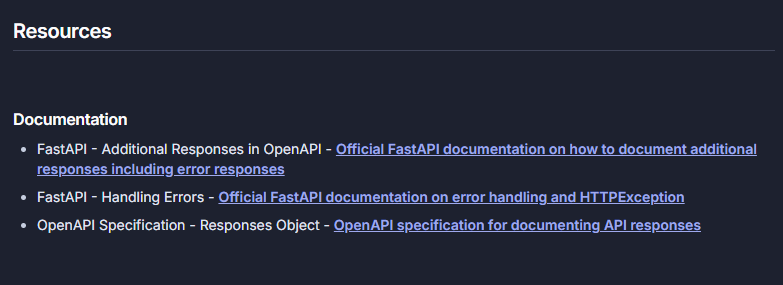