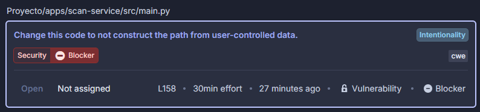
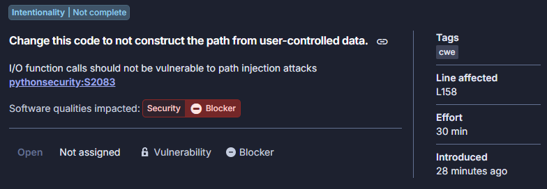
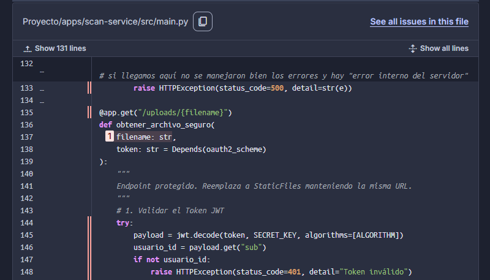
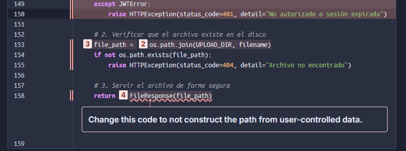
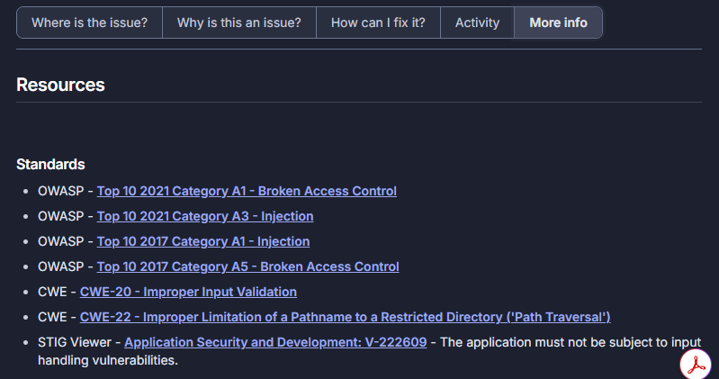
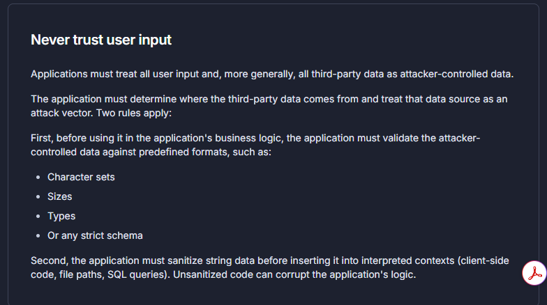
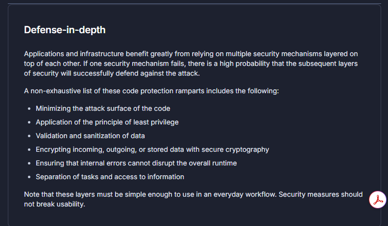

# Issue



## Issue Description



## Where's the Issue?

> Proyecto/apps/scan-service/src/main.py

```
# si llegamos aquí no se manejaron bien los errores y hay "error interno del servidor"
        raise HTTPException(status_code=500, detail=str(e))
@app.get("/uploads/{filename}")
def obtener_archivo_seguro(
    
filename: str, 
    token: str = Depends(oauth2_scheme)
):
    """
    Endpoint protegido. Reemplaza a StaticFiles manteniendo la misma URL.
    """
    # 1. Validar el Token JWT
    try:
        payload = jwt.decode(token, SECRET_KEY, algorithms=[ALGORITHM])
        usuario_id = payload.get("sub")
        if not usuario_id:
            raise HTTPException(status_code=401, detail="Token inválido")
    except JWTError:
        raise HTTPException(status_code=401, detail="No autorizado o sesión expirada")
    # 2. Verificar que el archivo existe en el disco

file_path = 

os.path.join(UPLOAD_DIR, filename)
    if not os.path.exists(file_path):
        raise HTTPException(status_code=404, detail="Archivo no encontrado")
    # 3. Servir el archivo de forma segura
    return 

FileResponse(file_path)
```





## Why is this an Issue?

Path injections occur when an application uses untrusted data to construct a file path and access this file without validating its path first.

A user with malicious intent would inject specially crafted values, such as ../, to change the initial intended path. The resulting path would resolve somewhere in the filesystem where the user should not normally have access to.

What is the potential impact?
A web application is vulnerable to path injection and an attacker is able to exploit it.

The files that can be affected are limited by the permission of the process that runs the application. Worst case scenario: the process runs with root privileges on Linux, and therefore any file can be affected.

Below are some real-world scenarios that illustrate some impacts of an attacker exploiting the vulnerability.

Override or delete arbitrary files
The injected path component tampers with the location of a file the application is supposed to delete or write into. The vulnerability is exploited to remove or corrupt files that are critical for the application or for the system to work properly.

It could result in data being lost or the application being unavailable.

Read arbitrary files
The injected path component tampers with the location of a file the application is supposed to read and output. The vulnerability is exploited to leak the content of arbitrary files from the file system, including sensitive files like SSH private keys.

## How can I fix it?

### How can I fix it in Flask?

The following code is vulnerable to path injection as it creates a path using untrusted data without validation.

In this particular case, the code can be exploited with the following input to read arbitrary files outside of the intended directory:
```
../../../../
```

#### Noncompliant code example

```
from flask import Flask, request, send_from_directory

app = Flask('example')

@app.route('/example')
def example():
    my_file = request.args['my_file']
    return send_file("static/%s" % my_file, as_attachment=True) # Noncompliant
```

#### Compilant Solution

```
from flask import Flask, request, send_from_directory

app = Flask('example')

@app.route('/example')
def example():
    my_file = request.args['my_file']
    return send_from_directory('static', my_file)
```

#### How does this works?

The universal method to prevent path injection is to validate paths created from untrusted data. This can be done either manually or automatically, depending on whether the library includes a data sanitization feature and the required function.

Here, send_from_directory can be considered a secure-by-design API.

#### Use secure-by-design APIs

Some libraries contain APIs with these three capabilities:
- File retrieval in a file system
- Restriction of the file retrieval to a specific folder (thus sanitizing and validating untrusted data).
- A feature, such as a file download or file deletion.

They can be referred to as "secure-by-design" APIs. Using this type of API, such as 'send_from_directory', brings multiple layers of security to the code while keeping the code base shorter.

Behind the scenes, this function protects against both regular and partial path injection.

#### Pitfalls

Do not use os.path.join as a validator
The [official documentation](https://docs.python.org/3/library/os.path.html#os.path.join) states that if any argument other than the first is an absolute path, any previous argument is discarded.

This means that including untrusted data in any of the parameters and using the resulting string for file operations may lead to a path traversal vulnerability.

If you want to learn more about this pitfall, read [our blog post about it.](https://www.sonarsource.com/blog/10-unknown-security-pitfalls-for-python/)

## More Info






