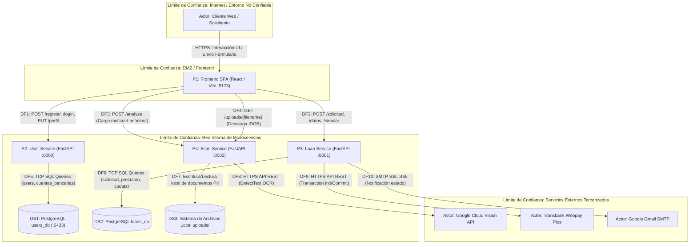

# INFORME DE MODELADO DE AMENAZAS (THREAT MODELING) Y ANÁLISIS DE RIESGO
## Proyecto: Plataforma de Gestión y Originación Crediticia "Segurito Dicen"
**Entrega:** Segunda Entrega de Seguridad de Software  
**Metodologías Aplicadas:** STRIDE Threat Modeling (OWASP Threat Dragon) y OWASP Risk Rating Methodology  
**Fecha:** Octubre 2026  

---

## 1. Resumen Ejecutivo y Alcance

El presente documento consolida la auditoría técnica de seguridad de software, modelado de amenazas y análisis formal de riesgos para la plataforma **Segurito Dicen**, un ecosistema de microservicios financieros orientado a la simulación, evaluación paramétrica de riesgo y originación de créditos de consumo.

La arquitectura bajo análisis se compone de:
1. **Frontend SPA (React / Vite)**: Interfaz de usuario para simulación, captura de documentos, confirmación de datos y firma digital de pagarés.
2. **User Service (FastAPI / PostgreSQL :8000)**: Gestión de identidades, registro de clientes, autenticación mediante JWT (OAuth2) y administración de perfiles.
3. **Loan Service (FastAPI / PostgreSQL :8001)**: Motor de scoring financiero, evaluación de solvencia, generación de planes de cuotas, integración con la pasarela de pagos Webpay Plus (Transbank) y despacho de notificaciones vía SMTP (Gmail).
4. **Scan Service (FastAPI :8002)**: Pipeline de ingestión documental, validación de firmas binarias (magic bytes), procesamiento OCR mediante Google Cloud Vision API y extracción estructurada de datos de solvencia (cédulas, liquidaciones, cotizaciones, deudas).
5. **Capa de Persistencia**: Bases de datos relacionales PostgreSQL (`users_db`, `loans_db`) y sistema de archivos local (`uploads/`).

A partir de la inspección estática del código fuente y los flujos transaccionales, se elaboró un Diagrama de Flujo de Datos (DFD) Nivel 1 y se modelaron las amenazas críticas bajo el estándar **STRIDE** utilizando **OWASP Threat Dragon v2**, evaluando su severidad mediante la **Metodología de Clasificación de Riesgos de OWASP (Risk Rating Methodology)**.

---

## 2. Diagrama de Flujo de Datos (DFD) y Límites de Confianza

### 2.1 Identificación de Componentes

* **Actores Externos (External Interactors):**
  * `Actor 1`: Cliente Web / Navegador (Solicitante de crédito desconfiable).
  * `Actor 2`: Google Cloud Vision API (Proveedor externo de reconocimiento óptico de caracteres).
  * `Actor 3`: Transbank Webpay Plus (Pasarela externa de procesamiento y recaudación de pagos).
  * `Actor 4`: Google Gmail SMTP (Servidor externo de despacho de correos electrónicos transaccionales).
* **Procesos (Processes):**
  * `P1`: Frontend SPA (`React` en puerto 5173).
  * `P2`: User Service (`FastAPI` en puerto 8000).
  * `P3`: Loan Service (`FastAPI` en puerto 8001).
  * `P4`: Scan Service (`FastAPI` en puerto 8002).
* **Almacenes de Datos (Data Stores):**
  * `DS1`: Base de datos de Usuarios (`PostgreSQL: users_db` en puerto mapeado 5433).
  * `DS2`: Base de datos de Créditos (`PostgreSQL: loans_db`).
  * `DS3`: Almacenamiento local de archivos escaneados (`uploads/` en el contenedor de Scan Service).
* **Límites de Confianza (Trust Boundaries):**
  * `TB1 (Límite Público / Internet)`: Separa el navegador del cliente de los servicios expuestos. Todo dato cruzando este límite debe considerarse potencialmente malicioso.
  * `TB2 (Límite de Red Interna / Backend)`: Demarca la infraestructura interna donde residen las bases de datos PostgreSQL y los canales de comunicación entre microservicios.

### 2.2 Diagrama Arquitectural DFD



---

## 3. Matriz de las 5 Amenazas Seleccionadas (STRIDE)

Para satisfacer los requerimientos de la entrega, se priorizaron los **5 vectores de ataque más críticos y evidentes del código fuente**, asegurando la presencia obligatoria de amenazas en **Proceso**, **Flujo de Datos** y **Almacén de Datos**:

| N° | ID Threat Dragon | Tipo de Componente | Componente Afectado | Categoría STRIDE | Título de la Amenaza | Severidad Preliminar |
|:--:|:---|:---|:---|:---|:---|:--:|
| **1** | `41b8a957-c812-4217-bf41-6e3e1577d611` | **Proceso** | `Loan Service (/solicitud)` | **Tampering** / **Elevation of Privilege** | Manipulación de Parámetros Financieros para Aprobación Fraudulenta de Créditos | **CRÍTICO** |
| **2** | `8f3b612d-1294-43cb-986c-7f5d448c3b12` | **Flujo de Datos** | `DF4: Cliente -> Scan Service (/uploads/{filename})` | **Information Disclosure** | Fuga Masiva de Documentos Sensibles por Falla de Autorización IDOR/BOLA | **ALTO** |
| **3** | `3b89ef54-7622-498c-b011-85d1e4e5cf44` | **Almacén de Datos** | `DS1/DS2: PostgreSQL & DS3: uploads/` | **Information Disclosure** / **Tampering** | Exposición de Credenciales Maestras en Repositorio y Base de Datos Expuesta | **CRÍTICO** |
| **4** | `c29f4510-8501-49b2-9d7a-1158a5be62aa` | **Proceso** | `Scan Service (/analyze)` | **Denial of Service** | Denegación de Servicio y Agotamiento de Facturación en OCR Cloud | **ALTO** |
| **5** | `99d3e8e1-5bc4-4061-a083-d5d342fe19cd` | **Proceso** | `Loan Service (/confirmar-pago)` | **Tampering** / **Elevation of Privilege** | Manipulación de Retorno y Falta de Autenticación en Confirmación de Pagos Webpay | **ALTO** |

---

## 4. Análisis Detallado de Vulnerabilidades y Cálculo de Riesgo OWASP

La **Metodología de Clasificación de Riesgos de OWASP (Risk Rating Methodology)** descompone el riesgo en dos factores fundamentales calculados en una escala normalizada de 0 a 9:
$$\text{Riesgo} = \text{Probabilidad (Likelihood)} \times \text{Impacto (Impact)}$$

* **Criterio de Nivel de Probabilidad e Impacto:**
  * `0.0 a < 3.0`: **LOW**
  * `3.0 a < 6.0`: **MEDIUM**
  * `6.0 a 9.0`: **HIGH**

* **Matriz Global de Riesgo:**
  * Si Probabilidad es **HIGH** e Impacto es **HIGH** $\rightarrow$ **CRITICAL**
  * Si Probabilidad es **HIGH** e Impacto es **MEDIUM** $\rightarrow$ **HIGH**
  * Si Probabilidad es **MEDIUM** e Impacto es **HIGH** $\rightarrow$ **HIGH**
  * Si Probabilidad es **MEDIUM** e Impacto es **MEDIUM** $\rightarrow$ **MEDIUM**

---

### Amenaza 1: Manipulación de Parámetros Financieros en Creación de Solicitud (Fraude Crediticio)
* **ID Threat Dragon:** `41b8a957-c812-4217-bf41-6e3e1577d611`
* **Tipo DFD:** Proceso (`P3: Loan Service - Endpoint /solicitud`)
* **Propiedad STRIDE Afectada:** **Tampering (T)** / **Elevation of Privilege (E)**
* **Mecánica de la Vulnerabilidad:**
  En `apps/loan-service/src/main.py` (líneas 44-75):
  ```python
  @app.post("/solicitud", response_model=schemas.SolicitudResponse)
  def crear_solicitud(solicitud: schemas.SolicitudCreate, ...):
      datos_prestamo = calcular_prestamo(solicitud.monto, solicitud.plazo)
      cuota_estimada = datos_prestamo["cuota_mensual"]
      resultado_evaluacion = evaluar_solicitud(
          ingreso_liquido=solicitud.liquidacion.sueldo_liquido,
          deudas_actuales=solicitud.deudas.deudas_totales,
          cuota_prestamo=cuota_estimada,
          tipo_contrato="Indefinido" 
      )
  ```
  Los datos de `sueldo_liquido` y `deudas_totales` son leídos directamente desde el objeto JSON proporcionado por el navegador del cliente. En `apps/frontend/src/components/solicitud/Formulario.jsx` (líneas 68-74), el frontend explícitamente permite a los usuarios editar los campos numéricos leídos por el OCR antes de enviarlos. No existe ningún chequeo criptográfico (HMAC), verificación asimétrica ni consulta inter-servicio directa entre `Loan Service` y `Scan Service` para constatar que los montos provienen fielmente del documento analizado. Adicionalmente, el RUT del carnet no es cotejado contra el RUT del usuario en sesión (`sub`).
* **Evaluación de Factores OWASP:**
  * **Probabilidad (Likelihood):**
    * *Skill Level (SL):* `3` (Cualquier usuario con conocimientos mínimos de inspección de red o uso de interfaz web).
    * *Motive (M):* `9` (Ganancia económica directa multimillonaria mediante obtención fraudulenta de préstamos).
    * *Opportunity (O):* `7` (Disponible para cualquier usuario que se registre con un correo y RUT).
    * *Size (S):* `6` (Grupo amplio de usuarios autenticados).
    * *Ease of Discovery (ED):* `9` (Evidente: la interfaz expone cajas de texto editables para sueldo y deudas).
    * *Ease of Exploit (EE):* `9` (Trivial: basta escribir un sueldo alto y deudas $0 en el formulario o en curl/Postman).
    * *Awareness (A):* `6` (Comportamiento evidente en la arquitectura).
    * *Intrusion Detection (ID):* `8` (La aplicación no audita inconsistencias ni levanta banderas rojas ante sueldos modificados).
    * **Puntaje de Probabilidad:** $(3+9+7+6+9+9+6+8) / 8 = \mathbf{7.13}$ $\rightarrow$ **HIGH**
  * **Impacto (Impact):**
    * *Técnico:* Pérdida de Confidencialidad (`1`), Pérdida de Integridad (`7`), Pérdida de Disponibilidad (`1`), Pérdida de Trazabilidad (`7`).
    * *Negocio:* Daño Financiero (`9`), Daño a la Reputación (`7`), No Cumplimiento Regulatorio (`7`), Violación de Privacidad (`5`).
    * **Puntaje de Impacto Global:** $(1+7+1+7+9+7+7+5) / 8 = \mathbf{5.50}$ (Impacto de Negocio: $\mathbf{7.00}$) $\rightarrow$ **HIGH / MEDIUM**
* **Vector OWASP:** `(SL:3/M:9/O:7/S:6/ED:9/EE:9/A:6/ID:8/LC:1/LI:7/LAV:1/LAC:7/FD:9/RD:7/NC:7/PV:5)`
* **Nivel de Riesgo Final:** **CRÍTICO / ALTO (CRITICAL)**
* **Recomendaciones de Tratamiento:**
  1. **Arquitectura Zero-Trust Cliente:** Desacoplar el envío de datos financieros del frontend. El resultado del OCR en `Scan Service` debe persistirse en un almacén de sesión de backend o emitirse como un token JWT firmado internamente (HMAC-SHA256 con llave privada inter-servicios) que el cliente no pueda adulterar.
  2. **Validación de Identidad Obligatoria:** Validar estrictamente en el backend que `solicitud.carnet.rut` sea idéntico al `rut` contenido en el token de autenticación del usuario (`usuario_id`).
  3. **Inhabilitación de Edición Manual:** Eliminar del frontend la posibilidad de sobreescribir montos salariales o deudas. En caso de discrepancia en el OCR, la solicitud debe derivarse a una cola de revisión manual ejecutada por un ejecutivo bancario acreditado.

---

### Amenaza 2: Fuga Masiva de Documentos Sensibles por Falla de Autorización IDOR/BOLA en Scan Service
* **ID Threat Dragon:** `8f3b612d-1294-43cb-986c-7f5d448c3b12`
* **Tipo DFD:** Flujo de Datos (`DF4: Cliente -> Scan Service /uploads/{filename}`)
* **Propiedad STRIDE Afectada:** **Information Disclosure (I)**
* **Mecánica de la Vulnerabilidad:**
  En `apps/scan-service/src/main.py` (líneas 142-178):
  ```python
  @app.get("/uploads/{filename}")
  def obtener_archivo_seguro(filename: str, token: str = Depends(oauth2_scheme)):
      try:
          payload = jwt.decode(token, SECRET_KEY, algorithms=[ALGORITHM])
          usuario_id = payload.get("sub")
          if not usuario_id:
              raise HTTPException(status_code=401, detail="Token inválido")
      except JWTError:
          raise HTTPException(status_code=401, detail="No autorizado...")
      ...
      return FileResponse(file_path)
  ```
  La función implementa una verificación de existencia de token JWT, pero **omite por completo la verificación de autorización sobre el recurso** (Broken Object Level Authorization / IDOR). No valida si el archivo `filename` fue subido por el `usuario_id` que realiza la petición. Cualquier usuario registrado puede consultar o enumerar nombres de archivos UUID y descargar los documentos de identidad, certificados de sueldo y deudas de cualquier otro usuario. Además, el protocolo de transporte es HTTP en texto claro (`http://localhost:8002/uploads/...`), expuesto a interceptación en redes locales o públicas.
* **Evaluación de Factores OWASP:**
  * **Probabilidad (Likelihood):**
    * $SL: 3$, $M: 7$, $O: 7$, $S: 6$, $ED: 7$, $EE: 5$, $A: 6$, $ID: 9$.
    * **Puntaje de Probabilidad:** $(3+7+7+6+7+5+6+9) / 8 = \mathbf{6.25}$ $\rightarrow$ **HIGH**
  * **Impacto (Impact):**
    * *Técnico:* $LC: 7$, $LI: 1$, $LAV: 1$, $LAC: 1$.
    * *Negocio:* $FD: 5$, $RD: 7$, $NC: 7$, $PV: 7$.
    * **Puntaje de Impacto Global:** $(7+1+1+1+5+7+7+7) / 8 = \mathbf{4.50}$ (Impacto en Privacidad y Legal: $\mathbf{7.00}$) $\rightarrow$ **MEDIUM / HIGH**
* **Vector OWASP:** `(SL:3/M:7/O:7/S:6/ED:7/EE:5/A:6/ID:9/LC:7/LI:1/LAV:1/LAC:1/FD:5/RD:7/NC:7/PV:7)`
* **Nivel de Riesgo Final:** **ALTO (HIGH)**
* **Recomendaciones de Tratamiento:**
  1. **Control BOLA Estricto:** Almacenar en la base de datos la asociación entre el `filename` generado y el `usuario_id` que subió el documento. Al solicitar `/uploads/{filename}`, validar obligatoriamente que `documento.usuario_id == current_user.id`.
  2. **URLs Prefirmadas Temporales:** Migrar el almacenamiento a un repositorio de objetos (MinIO / S3 / Cloud Storage) y generar *Pre-signed URLs* con expiración corta (máximo 15 minutos), eliminando el endpoint estático directo.
  3. **Transporte Seguro Obligatorio:** Habilitar TLS 1.3 / HTTPS en todos los microservicios y marcar cookies o tokens con banderas de seguridad (`Secure`, `HttpOnly`).

---

### Amenaza 3: Exposición de Credenciales Maestras en Repositorio y Base de Datos Expuesta
* **ID Threat Dragon:** `3b89ef54-7622-498c-b011-85d1e4e5cf44`
* **Tipo DFD:** Almacén de Datos (`DS1: PostgreSQL users_db`, `DS2: loans_db`, `DS3: uploads/`)
* **Propiedad STRIDE Afectada:** **Information Disclosure (I)** / **Tampering (T)**
* **Mecánica de la Vulnerabilidad:**
  1. Los archivos `.env` en la raíz del proyecto y en los microservicios contienen contraseñas de superusuario en texto claro (`DB_USER=user_admin`, `DB_PASSWORD=PCt7wo4!`, `GMAIL_APP_PASSWORD=...`, `SECRET_KEY=...`) y se encuentran bajo control de versiones en Git debido a que `.gitignore` únicamente excluye patrones `.R*`.
  2. En `docker-compose.yml` (líneas 10-11), el puerto del motor de base de datos se encuentra mapeado y expuesto al host externo:
     ```yaml
     ports:
       - "5433:5432"
     ```
  3. Los archivos de documentos de identidad se guardan en el sistema de archivos del servidor en texto plano sin cifrado en reposo (AES-256).
* **Evaluación de Factores OWASP:**
  * **Probabilidad (Likelihood):**
    * $SL: 5$, $M: 9$, $O: 7$, $S: 4$, $ED: 9$, $EE: 9$, $A: 9$, $ID: 9$.
    * **Puntaje de Probabilidad:** $(5+9+7+4+9+9+9+9) / 8 = \mathbf{7.63}$ $\rightarrow$ **HIGH**
  * **Impacto (Impact):**
    * *Técnico:* $LC: 9$, $LI: 9$, $LAV: 9$, $LAC: 7$.
    * *Negocio:* $FD: 9$, $RD: 9$, $NC: 7$, $PV: 7$.
    * **Puntaje de Impacto Global:** $(9+9+9+7+9+9+7+7) / 8 = \mathbf{8.25}$ $\rightarrow$ **HIGH / CRITICAL**
* **Vector OWASP:** `(SL:5/M:9/O:7/S:4/ED:9/EE:9/A:9/ID:9/LC:9/LI:9/LAV:9/LAC:7/FD:9/RD:9/NC:7/PV:7)`
* **Nivel de Riesgo Final:** **CRÍTICO (CRITICAL)**
* **Recomendaciones de Tratamiento:**
  1. **Purga Inmediata de Secretos:** Utilizar `git-filter-repo` o `bfg` para eliminar todos los archivos `.env` del historial de Git y rotar de inmediato todas las contraseñas de bases de datos, llaves secretas JWT y contraseñas de aplicación de Google.
  2. **Aislamiento de Red Docker:** Eliminar la directiva `ports: - "5433:5432"` en `docker-compose.yml`. La base de datos debe residir exclusivamente en una red interna privada (`internal: true`) accesible únicamente por los contenedores de los microservicios.
  3. **Cifrado en Reposo (Encryption at Rest):** Habilitar cifrado a nivel de volumen para PostgreSQL y almacenar los documentos de identidad en volúmenes cifrados con AES-256 (LUKS o KMS en la nube).

---

### Amenaza 4: Denegación de Servicio y Agotamiento de Facturación en OCR Cloud (Google Cloud Vision)
* **ID Threat Dragon:** `c29f4510-8501-49b2-9d7a-1158a5be62aa`
* **Tipo DFD:** Proceso (`P4: Scan Service - Endpoint /analyze`)
* **Propiedad STRIDE Afectada:** **Denial of Service (D)**
* **Mecánica de la Vulnerabilidad:**
  En `apps/scan-service/src/main.py` (líneas 45-66):
  ```python
  @app.post("/analyze", ...)
  async def analyze_document(
      file: UploadFile = File(...),
      document_type: str = Form(...)
  ):
      content = await file.read()
      ...
      raw_text = ocr_engine.detect_text(content)
  ```
  El endpoint carece de autenticación (es completamente público y anónimo). No tiene limitador de tasa de peticiones (Rate Limiting) ni mecanismo de detección de bots (CAPTCHA). Adicionalmente, ejecuta `await file.read()` en memoria sin restringir el encabezado `Content-Length`. Un atacante puede ejecutar un script automatizado que envíe miles de imágenes o archivos PDF simultáneamente, agotando la memoria RAM y el espacio de disco del servidor, e incurriendo en cobros financieros masivos en la tarjeta de crédito asociada a la API de Google Cloud Vision (Financial DoS).
* **Evaluación de Factores OWASP:**
  * **Probabilidad (Likelihood):**
    * $SL: 3$, $M: 5$, $O: 9$, $S: 9$, $ED: 9$, $EE: 9$, $A: 6$, $ID: 8$.
    * **Puntaje de Probabilidad:** $(3+5+9+9+9+9+6+8) / 8 = \mathbf{7.25}$ $\rightarrow$ **HIGH**
  * **Impacto (Impact):**
    * *Técnico:* $LC: 1$, $LI: 1$, $LAV: 7$, $LAC: 9$.
    * *Negocio:* $FD: 7$, $RD: 5$, $NC: 2$, $PV: 1$.
    * **Puntaje de Impacto Global:** $(1+1+7+9+7+5+2+1) / 8 = \mathbf{4.13}$ (Impacto en Disponibilidad y Finanzas: $\mathbf{7.00}$) $\rightarrow$ **MEDIUM / HIGH**
* **Vector OWASP:** `(SL:3/M:5/O:9/S:9/ED:9/EE:9/A:6/ID:8/LC:1/LI:1/LAV:7/LAC:9/FD:7/RD:5/NC:2/PV:1)`
* **Nivel de Riesgo Final:** **ALTO (HIGH)**
* **Recomendaciones de Tratamiento:**
  1. **Autenticación Obligatoria:** Requerir `token: str = Depends(oauth2_scheme)` en `/analyze` para que solo usuarios con cuenta activa puedan subir archivos a procesar.
  2. **Rate Limiting y CAPTCHA:** Integrar un middleware de limitación de tasa (ej. `slowapi` con límite de 5 peticiones por minuto por IP/usuario) y validar un token de CAPTCHA (Cloudflare Turnstile o reCAPTCHA v3) previo a la subida.
  3. **Límite de Tamaño de Carga:** Configurar en FastAPI o Nginx un tamaño máximo de cuerpo de petición (ej. 5 MB) antes de leer los datos en la memoria del proceso.
  4. **Protección Presupuestaria Cloud:** Configurar alertas de presupuesto y topes de cuota dura en Google Cloud Console para suspender el consumo de la API Vision en caso de anomalías imprevistas.

---

### Amenaza 5: Manipulación de Retorno y Ausencia de Autenticación en Confirmación de Pagos Webpay
* **ID Threat Dragon:** `99d3e8e1-5bc4-4061-a083-d5d342fe19cd`
* **Tipo DFD:** Proceso (`P3: Loan Service - Endpoint /prestamos/confirmar-pago`)
* **Propiedad STRIDE Afectada:** **Tampering (T)** / **Elevation of Privilege (E)**
* **Mecánica de la Vulnerabilidad:**
  En `apps/loan-service/src/main.py` (líneas 257-335):
  ```python
  @app.post("/prestamos/confirmar-pago")
  def confirmar_pago_webpay(
      datos_retorno: dict, 
      background_tasks: BackgroundTasks,
      db: Session = Depends(get_db)
  ):
      ...
      prestamo_id = datos_retorno.get("prestamo")
      cuotas_ids_str = datos_retorno.get("cuotas")
  ```
  1. El endpoint **no exige autenticación de sesión** (carece de `usuario_id: str = Depends(get_current_user_id)`).
  2. Los datos de las cuotas y el ID del préstamo son transmitidos mediante parámetros de consulta en la URL de retorno del frontend (`return_url = f"http://localhost:5173/?cuotas={cuotas_str}&prestamo={prestamo_id}"`), lo que permite que un usuario manipule los identificadores o reenvíe peticiones.
  3. Las llaves de integración comercial de Transbank se encuentran codificadas en duro en el código fuente (`WebpayOptions("597055555532", "579B532A...", IntegrationType.TEST)`).
  4. Aunque el sistema valida que el monto pagado coincida con la suma de cuotas, no existe una tabla de auditoría con candado de idempotencia sobre el `token_ws`, permitiendo condiciones de carrera (Race Conditions) y desincronización de estados contables.
* **Evaluación de Factores OWASP:**
  * **Probabilidad (Likelihood):**
    * $SL: 5$, $M: 9$, $O: 7$, $S: 6$, $ED: 7$, $EE: 5$, $A: 6$, $ID: 8$.
    * **Puntaje de Probabilidad:** $(5+9+7+6+7+5+6+8) / 8 = \mathbf{6.63}$ $\rightarrow$ **HIGH**
  * **Impacto (Impact):**
    * *Técnico:* $LC: 1$, $LI: 7$, $LAV: 1$, $LAC: 7$.
    * *Negocio:* $FD: 7$, $RD: 5$, $NC: 7$, $PV: 1$.
    * **Puntaje de Impacto Global:** $(1+7+1+7+7+5+7+1) / 8 = \mathbf{4.50}$ (Integridad y Cumplimiento: $\mathbf{7.00}$) $\rightarrow$ **MEDIUM / HIGH**
* **Vector OWASP:** `(SL:5/M:9/O:7/S:6/ED:7/EE:5/A:6/ID:8/LC:1/LI:7/LAV:1/LAC:7/FD:7/RD:5/NC:7/PV:1)`
* **Nivel de Riesgo Final:** **ALTO (HIGH)**
* **Recomendaciones de Tratamiento:**
  1. **Autenticación y Pertenencia del Préstamo:** Proteger `/prestamos/confirmar-pago` exigiendo sesión activa del titular y validando en base de datos que las cuotas pertenezcan al préstamo del usuario autenticado.
  2. **Idempotencia Transaccional y Auditoría:** Crear una tabla `transacciones_webpay` que registre el `token_ws`, monto, código de autorización y estado (`INICIADA`, `CONFIRMADA`, `FALLIDA`). Si un `token_ws` ya fue procesado, rechazar solicitudes posteriores inmediatamente.
  3. **Seguridad de Credenciales:** Mover el código de comercio y llave secreta de Transbank a variables de entorno gestionadas en el servidor, eliminándolas de los repositorios de código.

---

## 5. Instrucciones para la Entrega y Verificación

Los archivos generados para esta entrega se encuentran en el directorio raíz del proyecto:

1. **Modelo de Amenazas Threat Dragon (JSON):**
   * Archivo: [`threat-model-segurito.json`](threat-model-segurito.json)
   * Compatible con: **OWASP Threat Dragon v2** (aplicación web oficial en [https://threatdragon.github.io](https://threatdragon.github.io) o cliente de escritorio).
   * Contenido: DFD Nivel 1 completo con límites de confianza, procesos, almacenes de datos, flujos de datos y las 5 amenazas mapeadas con sus IDs únicos.
2. **Matriz de Análisis de Riesgo OWASP (Hojas de Cálculo):**
   * Archivo CSV (Separador `;` para Excel en español): [`analisis_riesgo_owasp.csv`](analisis_riesgo_owasp.csv)
   * Archivo CSV Estándar (Separador `,`): [`analisis_riesgo_owasp_comma.csv`](analisis_riesgo_owasp_comma.csv)
   * Contenido: Tabla con IDs de Threat Dragon, STRIDE, descripciones, desglose cuantitativo de los 16 factores OWASP, vector asociado y recomendaciones de tratamiento.
3. **Archivo Comprimido de Entrega:**
   * Se recomienda comprimir los archivos `threat-model-segurito.json`, `analisis_riesgo_owasp.csv` y el presente informe en un archivo `.zip` para la entrega académica.
